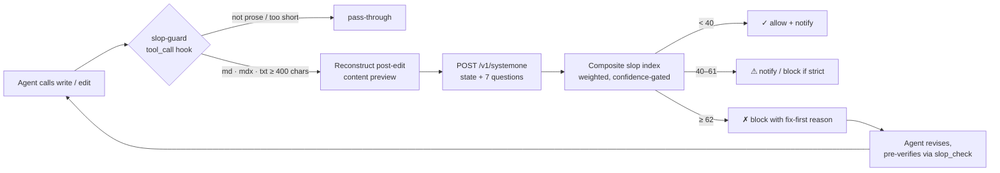

# slop-guard

A [pi](https://github.com/earendil-works/pi-coding-agent) extension that guards prose writes against AI slop — powered by [TypeSafe](https://typesafe.ai)'s **Jev**, a System One decision model.

Instead of a slow LLM critique round-trip ("paste this into a big model, ask if it's slop, parse the essay you get back"), slop-guard sends the draft to Jev **once** with a battery of atomic, typed questions. Jev evaluates all of them in parallel and returns calibrated scores and probabilities — no text generation, no parsing. The composition (weights, thresholds, verdicts) lives in this repo, where changing your mind means editing a coefficient, not rewriting a prompt.

## How it works



The question battery (all in one Jev call):

| id | type | weight | asks |
|---|---|---|---|
| `specificity` | score 0–3 | 3 | concrete anchors vs interchangeable boilerplate |
| `cliche_load` | score 0–3 | 3 | stock AI phrasing ("delve", "game-changer", …) |
| `voice` | score 0–3 | 2 | human point of view vs flat model cadence |
| `hollow_structure` | score 0–3 | 2 | filler sections, list-crutches, vacuous conclusions |
| `hedging` | noul | 1 | empty qualifiers instead of committed claims |
| `fake_depth` | noul | 1 | performed insight, nothing checkable |
| `dominant_issue` | choice | — | diagnosis for the block reason (`generic` / `cliche` / `structure` / `hedge` / `none`) |

Slop index = `100 · Σ(weight · normalized) / Σ(weight)`. Answers whose confidence is below `minConfidence` are excluded from the index (Jev's probability and confidence are different axes — this uses both).

## Setup

1. **API key** — get one at [console.typesafe.ai/settings/keys](https://console.typesafe.ai/settings/keys), then:

   ```fish
   set -Ux TYPESAFE_API_KEY ts_...
   ```

   (On your nix setup, a `sops-nix` session secret or `.env` works too — anything that exports `TYPESAFE_API_KEY`.)

2. **Install the extension** — symlink this repo into pi's auto-discovery dir:

   ```fish
   ln -s ~/personal/nyi/slop-guard ~/.pi/agent/extensions/slop-guard
   ```

   Or add it to `~/.pi/agent/settings.json` instead:

   ```json
   { "extensions": ["/Users/pratos/personal/nyi/slop-guard"] }
   ```

   Hot-reloads with `/reload` after edits.

## Usage

- **Automatic** — any `write`/`edit` on `*.md`, `*.mdx`, `*.markdown`, `*.txt` (≥ 400 non-space chars) is scored first. Pass → toast with the index. Block → the tool call is rejected with an actionable reason (failing checks + fix-first directive). The agent revises and retries.
- `/slop <path>` — score a file now and show the **scorecard**: a bordered overlay card with the index gauge (threshold ticks at ⚠40/✗62), per-dimension bars colored by severity, dominant issue, and the fix-first line. `esc`/`enter`/`q` closes.
- `/slop last` — reopen the scorecard for the most recent report (handy right after a guard block)
- `/slop` — status: config, key, totals, last report
- `/slop on` / `/slop off` — toggle for this session
- `/slop strict` / `/slop loose` — whether warn-level (40–61) blocks or just notifies
- `slop_check` tool — the agent can pre-verify text before writing; also handy for you to call explicitly ("run slop_check on this draft")

Headless preview of the same card (ANSI palette, simulated answers when no key):

```fish
bun run scripts/scorecard-demo.ts demo/arsenal-slop.md
```

Fail-open: if the key is missing, the API errors, or the request times out, the write is allowed and you get a `slop-guard offline` notice. A guard that eats your writes because its API is down would be worse than no guard.

## Config

`~/.pi/agent/slop-guard.json` (global) and `<project>/.pi/slop-guard.json` (overrides, trusted projects only). Values support `$ENV_VAR` expansion.

```jsonc
{
  "apiKey": "$TYPESAFE_API_KEY",
  "baseUrl": "https://api.typesafe.ai",
  "model": "jev-latest",
  "include": ["**/*.md", "**/*.mdx", "**/*.markdown", "**/*.txt"],
  "exclude": ["**/node_modules/**", "**/.pi/**", "**/.visuals/**", "**/CHANGELOG.md"],
  "minChars": 400,
  "blockThreshold": 62,
  "warnThreshold": 40,
  "minConfidence": 0.35,
  "strict": false,
  "enabled": true,
  "timeoutMs": 20000,
  "maxStateChars": 48000
}
```

## Dev

```fish
bun install
bun run check   # tsc --noEmit
bun run smoke   # offline tests: globs, edit preview, scoring, formatting
```

`scripts/smoke.ts` covers the pure logic without an API key.

## Known gaps

- `bash`-written files (heredocs, `sed`, `tee`) bypass the guard — only `write`/`edit` tools are intercepted.
- Edit previews are reconstructed from `oldText` spans; if an `oldText` can't be located, the preview falls back to the new text alone and the report is marked *approx*.
- Jev judges the whole text; a surgical 2-line edit to an already-sloppy file can block even if the edit itself is fine. Lower `blockThreshold`… no wait, *raise* it, or use `/slop off` for reflow work.
